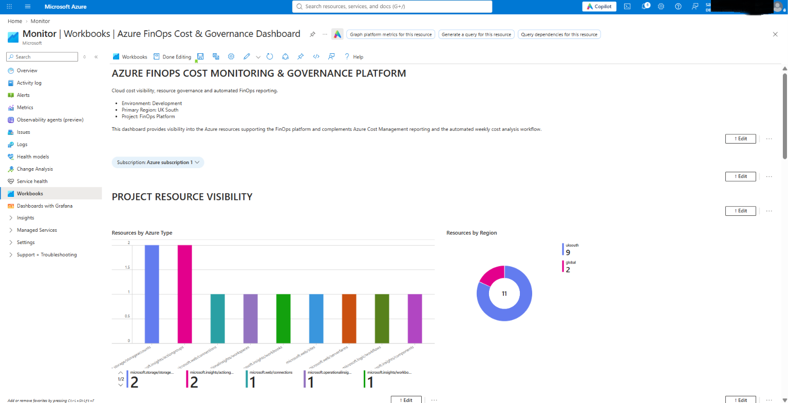
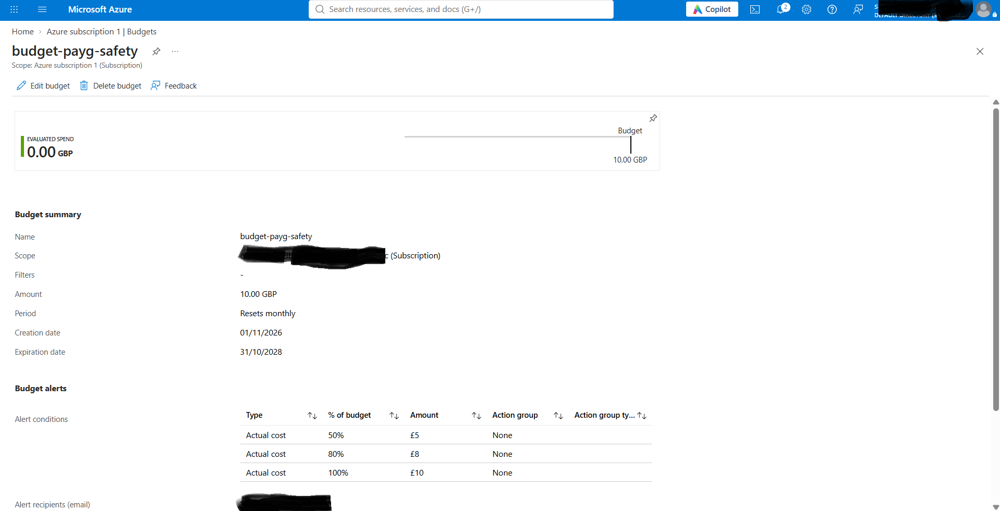
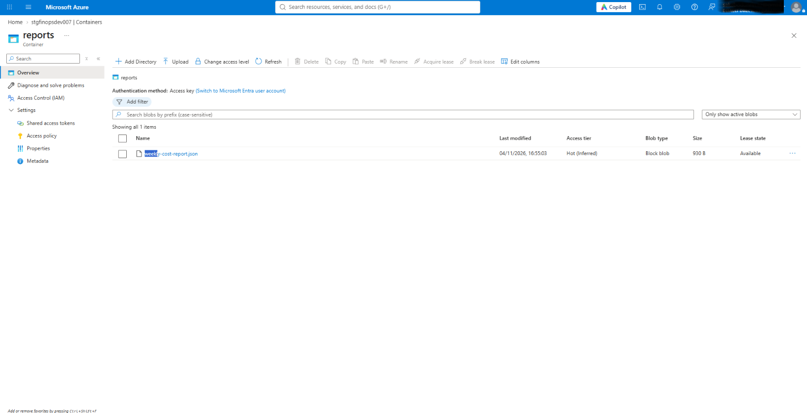
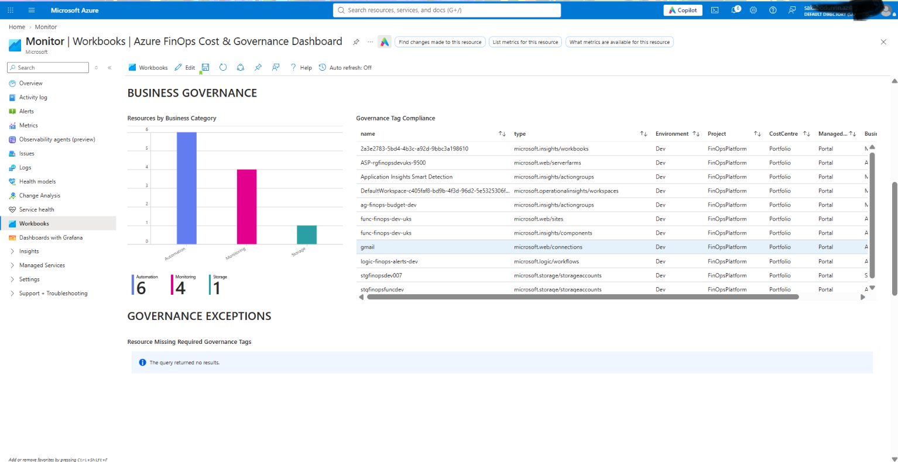
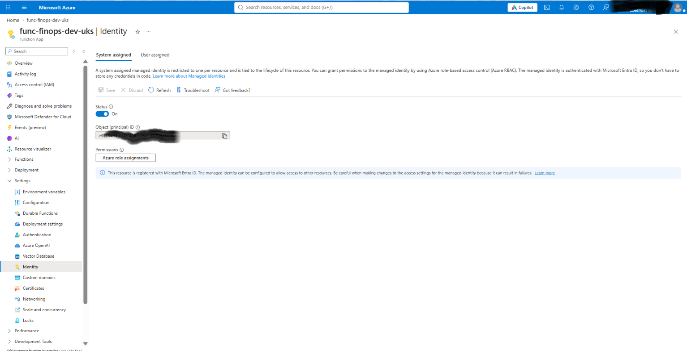

# Azure FinOps Cost Monitoring & Governance Platform

A hands-on Azure portfolio project demonstrating cost governance, automated reporting, monitoring, managed identity, Azure RBAC and Infrastructure as Code with Bicep.

The platform provides visibility into Azure expenditure and resource governance while automating budget notifications, cost-data exports and weekly cost analysis.


*Figure 1: Azure FinOps dashboard showing resource and regional visibility*

## Project Overview
This project implements a lightweight FinOps platform for monitoring Azure costs, applying governance controls and automating recurring cost analysis.

The solution combines:
- Azure Cost Management
- Subscription-level budgeting
- Automated budget threshold alerts
- Azure Monitor Action Groups
- Logic App notifications
- Daily Actual Cost exports
- Azure Blob Storage
- Python Azure Functions
- Application Insights
- Azure Resource Graph
- Azure Monitor Workbooks
- Managed identities and Azure RBAC
- Bicep Infrastructure as Code

The environment was initially created and validated through the Azure Portal before being progressively migrated to modular Bicep Infrastructure as Code.

## Project Objectives
The project was designed to demonstrate how Azure-native services can be combined to build a practical FinOps and governance platform.

The main objectives were to:
- Monitor Azure expenditure
- Apply subscription-level cost guardrails
- Generate alerts before unexpected spending becomes significant
- Export detailed Azure cost data for further processing
- Automate recurring cost analysis
- Compare recent spending periods
- Identify top Azure services and resource groups by cost
- Improve governance through tagging
- Identify resources missing required governance tags
- Avoid embedded credentials through managed identities
- Represent the platform using Infrastructure as Code
- Keep the solution lightweight and cost-conscious

## Cost-Conscious Architecture
The platform was intentionally designed as a lightweight FinOps solution with a focus on minimising idle infrastructure and ongoing operational cost.

Where practical, the solution uses serverless and consumption-based Azure services rather than continuously running compute.

Key design choices include:
- Azure Functions Flex Consumption for scheduled cost-processing workloads
- Event-driven Logic App automation for budget notifications
- Azure Blob Storage for cost exports and generated reports
- Managed identities instead of credential-management infrastructure
- Azure Cost Management for native budgeting and cost exports
- Azure Resource Graph and Azure Workbooks for governance visibility

The Python cost-analysis workload runs on a schedule rather than requiring continuously running compute.

This makes the architecture suitable for a small development or portfolio environment while still demonstrating production-relevant FinOps, automation, governance, identity and Infrastructure as Code patterns.

The solution is not intended to be described as free. Azure service usage can still incur charges. The design instead focuses on reducing unnecessary always-on infrastructure and aligning compute usage with actual workload execution.

## Solution Flow
The platform contains three main operational flows.

### Cost Governance and Alerting
Azure Cost Management -> Subscription Budget -> 50%/80%/100% thresholds -> Azure Monitor Action Group -> Azure Logic App -> Email notification

Budget notifications provide early visibility into PAYG subscription spending.


*Figure 2: PAYG subscription budget used for proactive Azure cost governance*

### Automated Cost Reporting
Azure Cost Management -> Actual Cost Export -> Azure Blob Storage -> cost-exports -> Timer-triggered Python Azure Function -> Seven-day cost comparison -> reports -> weekly-cost-report.json

Cost Management exports Actual Cost data into Blob Storage.

A timer-triggered Python Azure Function processes the exported data and compares:
- Latest seven days of available costs
- Previous seven-day period
- Total spending change
- Percentage change
- Top Azure services
- Top resource groups
- Largest service-level cost increases

The generated report is written to: `reports/weekly-cost-report.json`


*Figure 3: Automated weekly cost report generated by the Python Azure Function and stored in Blob Storage*

### Resource Governance and Visibility
Azure Resources -> Azure Resource Graph -> Azure Monitor Workbook -> FinOps Governance Dashboard

Azure Resource Graph queries provide governance and inventory information
across the FinOps environment.

The Azure Monitor Workbook presents:

- Resources by Azure type
- Resources by region
- Resources by business category
- Governance tag compliance
- Resources missing required governance tags
- Resource inventory

Governance tags include: 
- Environment
- Project
- CostCentre
- ManagedBy
- BusinessCategory



*Figure 4: Azure Workbook showing governance tag compliance and resource visibility*

## Identity and Access

The platform uses managed identities and Azure RBAC to avoid embedding Storage Account credentials in the Azure Function.

The Function App uses a system-assigned managed identity.

The identity receives the permissions required for:

- Function runtime storage
- Function deployment package storage
- FinOps cost storage
- Application Insights monitoring

The Bicep infrastructure represents these relationships using Azure RBAC role assignments.

The Function managed identity currently uses roles including:

- Monitoring Metrics Publisher
- Storage Blob Data Owner
- Storage Blob Data Contributor

Permissions are assigned at the resource scopes required by the workload rather than relying on embedded Storage Account keys.


*Figure 5: System-assigned managed identity enabled for the Azure Function*

## Infrastructure as Code

The Azure environment was initially deployed and validated through the Azure Portal before being progressively migrated to Bicep.

Existing resources were captured, reviewed and refactored into reusable Infrastructure as Code definitions.

The final Bicep implementation separates resources according to their native Azure deployment scope.

### Resource-Group Scope

The main resource-group deployment manages:

- FinOps Storage Account
- Blob containers
- Function Storage
- Flex Consumption hosting plan
- Azure Function App
- Application Insights
- Azure Monitor Action Group
- Managed identity RBAC assignments
- Azure Workbook

### Subscription Scope

Separate subscription-level Bicep templates manage:

- Cost Management Budget
- Cost Management Actual Cost Export

This avoids treating subscription-level Cost Management resources as though they belong inside a resource group.

### Deployment Safety

Infrastructure changes follow: <br/>
Bicep build -> Azure validation -> What-if -> Deploy -> Post-deployment What-if

What-if is used to inspect predicted changes before Bicep is allowed to modify the working environment.

Detailed Bicep migration, parameterisation and deployment instructions are available in:

[Infrastructure documentation](infrastructure/README.md)

## Infrastructure Structure

```text
infrastructure/
├── README.md
├── main.bicep
├── main.bicepparam
│
├── modules/
│   ├── storage.bicep
│   ├── monitoring.bicep
│   ├── function.bicep
│   └── workbook.bicep
│
└── subscription/
    ├── budget.bicep
    ├── budget.bicepparam
    ├── cost-export.bicep
    └── cost-export.bicepparam
```
The Azure Workbook definition is version-controlled separately:
[Azure Workbook definition](workbook/finops-dashboard.workbook.json)

## Infrastructure Migration Approach

Existing Portal-created Azure resources were used as the starting point for the Bicep migration.

The migration process followed: <br/>
Portal Resource -> Capture Existing Resource (ID) -> Refactor into Bicep -> Parameterise Environment Values -> Separate Public and Local Parameters -> Build -> Validate -> What-if -> Deploy -> Verify

The detailed VS Code and Bicep migration process is documented in: [Infrastructure README](infrastructure/README.md)

## Azure Services Used

| Area | Azure Service |
|---|---|
| Cost governance | Azure Cost Management |
| Budgeting | Cost Management Budgets |
| Cost data | Cost Management Exports |
| Storage | Azure Blob Storage |
| Serverless compute | Azure Functions Flex Consumption |
| Automation | Azure Logic Apps |
| Alert routing | Azure Monitor Action Groups |
| Monitoring | Application Insights |
| Governance queries | Azure Resource Graph |
| Dashboard | Azure Monitor Workbooks |
| Identity | Microsoft Entra managed identities |
| Authorisation | Azure RBAC |
| Infrastructure as Code | Bicep |

---

## Project Status
**Status: ✅ Complete**
The platform has been deployed, tested and migrated to Bicep Infrastructure as Code. The sections below document the implementation phases.

## Project Implementation

The platform was developed progressively across seven phases, beginning with cost governance and finishing with a modular Infrastructure as Code
implementation.

### Phase 1 - Foundation and Cost Controls
  
**Configuration**

- Subscription: Azure Subscription 1 (PAYG)
- Primary region: UK South
- Environment: Development
- Monthly safety budget: £10

**Governance Tags**
|Tag | Value |
|---|---|
|Environment | Dev |
|Project | FinOpsPlatform |
|CostCentre | Portfolio |
|ManagedBy | Bicep |

**Design Decisions**
✅ Development resource group created. <br />
✅ UK South selected as the primary deployment region. <br />
✅ Governance tagging strategy established <br/>
✅ £10 monthly PAYG safety budget configured <br/>
✅ Cost controls established before deploying the wider workload 

A single development resource group is used for resources that share the project lifecycle, while subscription-scoped Cost Management resources are managed separately.

### Phase 2 - Cost Management and Governance
✅ Azure Cost Analysis explored <br />
✅ Subscription and project cost scopes defined <br />
✅ Project tagging strategy implemented <br />
✅ Business-friendly cost categories defined <br />
✅ Cost governance decisions documented <br />
✅ Azure-native cost information retained for technical analysis

The reporting strategy preserves Azure-native service information while introducing business-friendly categories for governance and stakeholder reporting.

### Phase 3 - Automated Cost Alerting
✅ Logic App notification workflow deployed <br />
✅ Azure Monitor Action Group configured <br />
✅ Subscription budget connected to Action Group <br />
✅ Automated email workflow configured <br />
✅ Budget alert workflow tested successfully<br />
✅ Alerting architecture documented

The alerting workflow connects Azure Cost Management budget thresholds to an Action Group, which invokes the Logic App notification workflow.

### Phase 4 - Cost Data Export and Storage
✅ FinOps Storage Account deployed <br/>
✅ `cost-exports` Blob container configured <br/>
✅ Cost Management Actual Cost export configured <br/>
✅ Daily Month-to-Date cost data exported <br/>
✅ CSV/Gzip export delivery verified in Blob Storage <br/>
✅ Export manifest inspected and validated <br/>
✅ Cost-export implementation documented

The Cost Management export provides the source data used by the automated weekly cost-analysis workflow.

### Phase 5 - Weekly Cost Analysis
✅ Python Azure Function developed <br/>
✅ Flex Consumption hosting configured <br/>
✅ Timer-triggered processing implemented <br/>
✅ Cost export data processed from Blob Storage <br/>
✅ System-assigned managed identity configured <br/>
✅ Azure RBAC configured for Storage and monitoring access <br/>
✅ Seven-day cost comparison implemented <br/>
✅ Weekly report written to Azure Storage <br/>
✅ Function execution verified successfully <br/>

The Function compares the latest seven days of available cost data with the previous seven-day period and produces a JSON report containing cost changes, top services and top resource groups.

### Phase 6 - FinOps Visibility Dashboard
✅ Azure Monitor Workbook created <br/>
✅ Azure Resource Graph queries implemented <br/>
✅ Resource inventory visualised <br/>
✅ Resource distribution by region and Azure service visualised <br/>
✅ Governance tag compliance visualised <br/>
✅ Missing-tag detection implemented <br/>
✅ Business-category reporting implemented <br/>
✅ Dashboard definition version-controlled <br/>

The Workbook provides a central governance view across the FinOps development environment and complements the financial reporting available through Azure Cost Management.

### Phase 7 - Infrastructure as Code
✅ Bicep project structure created <br/>
✅ Existing Portal-created resources captured and refactored into Bicep <br/>
✅ Storage infrastructure migrated to Bicep <br/>
✅ Monitoring infrastructure migrated to Bicep <br/>
✅ Azure Function infrastructure migrated to Bicep <br/>
✅ Workbook infrastructure migrated to Bicep <br/>
✅ Managed identities and RBAC represented as code <br/>
✅ Resource-group and subscription deployment scopes separated <br/>
✅ Cost Management Budget represented as subscription-scoped IaC <br/>
✅ Cost Management Actual Cost Export represented as subscription-scoped IaC <br/>
✅ Public and environment-specific parameter files separated <br/>
✅ Bicep build and Azure validation completed <br/>
✅ What-if reviews performed before infrastructure changes <br/>
✅ Infrastructure deployments verified <br/>
✅ Post-deployment What-if verification performed

The final implementation separates core workload infrastructure from subscription-level Cost Management resources and uses modular Bicep definitions for repeatable deployment.


## Repository Structure

```text
azure-finops-platform/
├── .funcignore
├── .gitignore
├── .vscode/
│
├── docs/
│   ├── alerting-architecture.md
│   ├── cost-export.md
│   ├── cost-governance.md
│   ├── cost-mapping.md
│   ├── dashboard.md
│   ├── weekly-cost-export.md
│   └── screenshots/
│
├── infrastructure/
│   ├── README.md
│   ├── main.bicep
│   ├── main.bicepparam
│   ├── modules/
│   └── subscription/
│
├── workbook/
│   └── finops-dashboard.workbook.json
│
├── function_app.py
├── host.json
├── requirements.txt
├── LICENSE
└── README.md
```

## Detailed Documentation

Additional implementation evidence and notes are available under `docs/`.

### Cost Governance
[docs/cost-governance.md](docs/cost-governance.md)

### Cost Export
[docs/cost-export.md](docs/cost-export.md) <br/>
[docs/weekly-cost-export.md](docs/weekly-cost-export.md)

### Cost Mapping
[docs/cost-mapping.md](docs/cost-mapping.md)

### Alerting
[docs/alerting-architecture.md](docs/alerting-architecture.md)

### Dashboard
[docs/dashboard.md](docs/dashboard.md)

### Infrastructure as Code
[infrastructure/README.md](infrastructure/README.md)

## Key Technical Decisions

### Serverless Compute

The scheduled analysis workload uses Azure Functions Flex Consumption rather
than continuously running compute.

### Managed Identity

The Azure Function uses a system-assigned managed identity for Azure resource access instead of storing Storage Account credentials in the application.

### Azure RBAC

Permissions are represented as Infrastructure as Code and scoped to the Azure resources used by the Function.

### Multi-Scope Bicep

Resource-group infrastructure and subscription-level Cost Management resources are maintained separately.

### Private Deployment Parameters

Public `.bicepparam` files contain example configuration.

Real environment-specific values are stored in ignored
`.local.bicepparam` files.

### External OAuth Authentication

The Gmail Logic Apps connector requires environment-specific OAuth consent.

OAuth credentials and tokens are intentionally excluded from the repository.

## Evidence

Supporting screenshots are stored under: <br/>
[docs/screenshots](docs/screenshots)

They include evidence of:

- Cost Analysis
- Subscription budgeting
- Budget alerting
- Cost Management exports
- Exported Blob data
- Action Group configuration and tests
- Logic App runs
- Azure Function execution
- Managed identity
- Generated weekly reports
- Azure Workbook dashboards
- Governance tagging

## Lessons Learned

This project strengthened my understanding of:

- Azure cost governance
- FinOps principles
- Azure Cost Management
- Budget alerting
- Serverless Azure Functions
- Managed identities
- Azure RBAC
- Azure Storage authentication
- Azure Resource Graph
- Azure monitoring
- Logic Apps automation
- Bicep modularisation
- Azure deployment scopes
- Infrastructure migration
- Deployment validation and What-if
- Cost-conscious cloud architecture

A particularly useful lesson was that migrating existing Azure resources into Infrastructure as Code involves more than simply exporting their current configuration.

Generated resource definitions can contain runtime-managed and environment-specific properties. These must be reviewed, refactored, parameterised and validated before the resources are safely managed through Bicep.

## Future Improvements

Potential future enhancements include:

- GitHub Actions for Infrastructure as Code validation
- GitHub-to-Azure authentication using OpenID Connect
- Additional FinOps anomaly detection
- Multi-environment Bicep configuration
- Multi-subscription cost visibility
- Additional cost trend visualisations
- Azure Key Vault integration where future secrets require centralised management

These enhancements are intentionally outside the current project scope.

## Security

No Azure credentials, Storage Account keys, SAS tokens, Logic App signed callback URLs, OAuth tokens or other authentication secrets are stored in source control.

Environment-specific deployment configuration is maintained through local parameter files excluded by `.gitignore`.

Managed identities and Azure RBAC are used where practical for Azure resource access.

## Disclaimer

This project was created as a personal Azure portfolio and learning project.

Resource names, subscription configuration, budgets and cost thresholds should be reviewed before adapting the solution for another Azure environment.

Azure services used by this solution can incur charges. Review current Azure pricing and configure appropriate budgets and cost controls before deploying equivalent infrastructure.

## Licence

See [LICENSE](LICENSE)